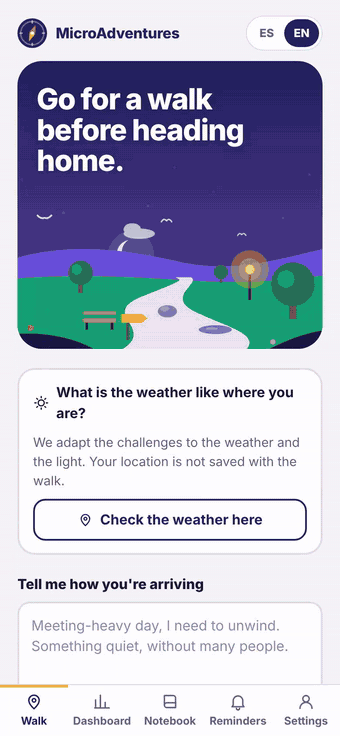
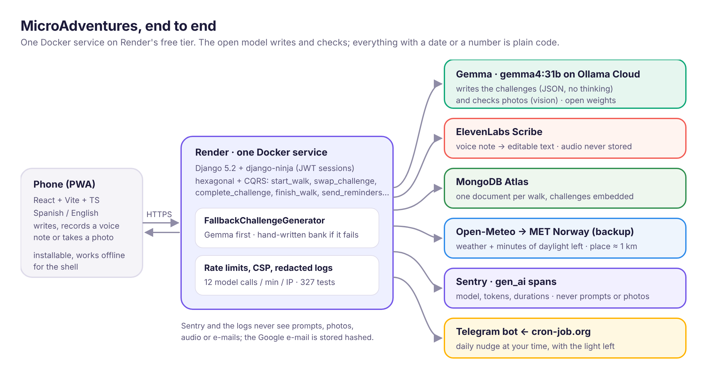

# MicroAdventures

**Three tiny walking challenges, written on the spot by an open-weight model, for the time you have, the light that's left and how you feel.** Touch something rough and tell me what it felt like; find the quietest sound in the street; spot a tree lit up by a streetlamp. Answer by writing, with a voice note or with a photo the model checks, and keep it all in a notebook.

Built for the [Hacktoberfest 2026 Open-Source AI Challenge, Week 1: "Touch Grass"](https://dev.to/challenges/hacktoberfest-week1-2026-10-05).

- **Live app:** https://micro-adventure.onrender.com (no account needed; on Render's free tier the first visit can take about a minute to wake up)
- **Video:** [`docs/media/day-and-night.mp4`](docs/media/day-and-night.mp4), "A day and a night with MicroAdventures" (2:23, real phones, narrated)
- **Privacy policy and terms:** [`/privacy.html`](https://micro-adventure.onrender.com/privacy.html) · [`/terms.html`](https://micro-adventure.onrender.com/terms.html)


## What it does

- **You tell it how you're arriving**, in your own words, how long you've got (15–60 minutes) and your energy. If you allow it, it reads the real weather and the daylight left where you are.
- **Gemma writes the challenges** (`gemma4:31b` on Ollama), one per category (touch, listen, city and culture, nature, people), in Spanish or English. After dark it only suggests lit, busy streets, and it never asks to photograph a person.
- **You answer by telling.** Write it, record a voice note (ElevenLabs turns it into text you can edit) or take a photo that Gemma's vision checks against the challenge.
- **Swap a challenge** twice per walk, then close the walk with the real minutes, kilometres and a few words.
- **It adds up:** a week and year dashboard, weekly reflections and a notebook of 67 stickers.
- **A nudge at the right time:** a daily Telegram card at the hour you choose, with the daylight left and the weather. "In 1 hour" brings it back, updated.
- **A short guide** the first time: bubbles over the tabs, and over the buttons of your first walk.
- **Private by default:** no sign-up and no e-mail. Your browser gets an anonymous id; Google is optional, only to restore your progress on another phone. One button in Settings deletes everything.

It's an installable web app (PWA), in Spanish and English.



## Stack

- **Backend:** Python 3.12, Django 5.2, django-ninja, Poetry. Hexagonal architecture with CQRS.
- **Database:** MongoDB Atlas through `django-mongodb-backend`, with regular Django models.
- **Model:** Gemma through Ollama (Ollama Cloud in production, or your own Ollama), for challenges and photo checks, with a hand-written bank of challenges as a fallback.
- **Voice:** ElevenLabs Scribe (speech to text).
- **Web client:** React 18, Vite, TypeScript, PWA (see [`web/README.md`](web/README.md)).
- **Reminders:** a Telegram bot, triggered by an external cron (cron-job.org).
- **Weather and daylight:** Open-Meteo, with MET Norway as a backup.
- **Observability:** Sentry (errors, logs and a `gen_ai.request` span for every model call).
- **Hosting:** one Docker service on Render's free tier, described in `render.yaml`.



## Architecture

Hexagonal architecture with CQRS. One bounded context: `microadventures`.

```
micro-adventure/
├── pyproject.toml / poetry.lock
├── src/
│   ├── manage.py
│   ├── core/                 # Settings, urls, middleware (CSP, rate limit, body size), Sentry scrubber
│   ├── mongo_migrations/     # Migrations of Django's own apps for MongoDB
│   ├── api/                  # Driving adapter: one django-ninja router per area (walks, account, auth,
│   │   │                     # reminders, telegram, summary, progress, context, diagnostics)
│   │   └── wiring.py         # Builds each handler with its real adapters
│   └── microadventures/
│       ├── domain/
│       │   ├── models/       # Walk, Challenge, Account, ReminderSettings, WeeklyReflection, stickers, sun…
│       │   ├── services/     # Abstract ports: WalkService, AccountService, ChallengeGenerator, PhotoVerifier…
│       │   └── exceptions/
│       ├── application/
│       │   ├── commands/     # One folder per use case: start_walk, swap_challenge, delete_account, accept_legal…
│       │   └── queries/      # find_walk, find_progress, find_weekly_summary, transcribe_audio…
│       ├── infrastructure/
│       │   ├── repositories/ # Db*Repository (MongoDB)
│       │   └── api/          # Ollama, ElevenLabs, Telegram, Open-Meteo, MET Norway
│       ├── management/       # find_support_code
│       └── migrations/
├── tests/                    # Mirrors src/, with in-memory fakes of every port (tests/fakes.py)
├── web/                      # React client, plus privacy.html and terms.html
├── docs/                     # Scripts that record the demo media and the video
└── scripts/                  # benchmark.py, gpu-droplet-setup.sh
```

Dependency rule: `infrastructure` and `api` depend on `application` and `domain`; `application` depends only on `domain`.

### Ports and adapters

| Port (`domain/services/`) | Adapters (`infrastructure/`) |
| --- | --- |
| `WalkService`, `AccountService`, `ReminderService`, `ReflectionService` | `Db*Repository` |
| `ChallengeGenerator` | `OllamaChallengeGenerator`, `TemplateChallengeGenerator`, `FallbackChallengeGenerator` |
| `PhotoVerifier` | `OllamaPhotoVerifier`, `TrustingPhotoVerifier` |
| `SpeechTranscriber` | `ElevenLabsSpeechTranscriber`, `UnavailableSpeechTranscriber` |
| `NotificationSender` / `BotWebhook` | `TelegramNotificationSender`, `UnavailableNotificationSender` |
| `WeatherService` | `OpenMeteoWeatherService`, `MetNorwayWeatherService`, `FallbackWeatherService` |
| `GoogleIdentityVerifier` | `GoogleIdTokenVerifier` |

The abstract port is a *Service* and its persistence implementation a *Repository*. Handlers depend on the port and receive the adapter.

### Gemma writes, plain code decides

The model only does what a model is good at: writing the challenges and looking at photos. Everything with a date, a number or a rule (how many challenges fit in a walk, whether it's dark enough to ask for lit streets, when a reminder goes out, which sticker you earned) is ordinary, tested code.

- What you write about your day goes into the prompt fenced off as *context, not instructions*.
- The code picks and shuffles the categories, one per challenge.
- The parser accepts whatever shape the model's JSON comes in (fences, bare strings, a single object, the category as the key); if it still fails, the template bank answers.
- Every challenge records who wrote it (`source`), and the app shows it: a green dot for the model, grey for the backup bank.
- `FallbackChallengeGenerator` uses the template bank when the model is slow or down; the start form calls `POST /api/warmup` so the model loads while you type.

### CQRS rules

- A **command** changes state and returns nothing. The caller creates any id it needs.
- A **query** returns data and never changes state.
- Each use case lives in `application/commands/<use_case>/` or `application/queries/<use_case>/` as `<use_case>_command.py` + `<use_case>_command_handler.py` (or `_query`). Handlers receive their ports in the constructor and expose a single `handle()`.

To add a use case: create the folder with the command or query and its handler, add a builder in `api/wiring.py`, add a route in the area's router under `api/` (and map its exceptions in `api/errors.py`), and test the handler with the fakes in `tests/fakes.py`.

## Privacy and security

- **Anonymous sessions.** The browser creates an id; `/api/auth/start` claims it once and returns signed JWTs (access 30 min, refresh 365 days). Every route under `/users/{user_id}` checks that the id in the URL is the one in the token.
- **Delete my account.** `DELETE /api/users/{user_id}/account` removes the walks, reflections, reminders (with the Telegram chat id) and the account. A refresh token whose account no longer exists is refused.
- **Terms accepted where it matters.** Until the first acceptance, a short notice sits next to the buttons that keep something (start a walk, save a name, connect Google or Telegram); the first tap records the version (`domain/models/legal.py`) and the time.
- **Less to third parties.** Photos are checked and never stored; voice notes are never stored, and the transcript is deleted at ElevenLabs as soon as the text comes back; the location is rounded to about a kilometre; fonts are served from our own server; Google's script only loads when you tap "Connect with Google"; only a one-way hash of the Google e-mail is kept.
- **Support code.** Settings shows `MA-XXXX-XXXX`, derived from the id, to quote by e-mail. `python src/manage.py find_support_code MA-XXXX-XXXX` finds the account.
- **Hardening.** Content Security Policy, HSTS, rate limits per user or IP (tighter on the routes that call the model), a body size limit, and a scrubber that keeps keys and tokens out of Sentry and the logs.

The privacy policy and terms (Spanish and English, written for the GDPR and the ePrivacy Directive) are `web/privacy.html` and `web/terms.html`.

## API

Every route except the ones marked *public* needs `Authorization: Bearer <access token>`. Swagger UI is served at `/api/docs` only when `DEBUG=True`.

| Method | Path | What it does |
| --- | --- | --- |
| GET | `/api/health` | Health check (*public*) |
| POST | `/api/auth/start` | Claim an anonymous id and get tokens (*public*) |
| POST | `/api/auth/refresh` | New tokens from a refresh token (*public*) |
| POST | `/api/warmup` | Load the model while the person writes |
| GET | `/api/context` | Weather and daylight for a rounded location |
| POST | `/api/walks` | Start a walk and generate its challenges |
| GET | `/api/walks/{walk_id}` | Find a walk |
| POST | `/api/walks/{walk_id}/challenges/{challenge_id}/complete` | Complete a challenge (multipart: `story` and/or `photo`) |
| POST | `/api/walks/{walk_id}/challenges/{challenge_id}/swap` | Swap a challenge (2 per walk) |
| POST | `/api/walks/{walk_id}/finish` | Close the walk: minutes, kilometres, diary |
| POST | `/api/transcribe` | Voice note (multipart `audio`) to text |
| GET | `/api/users/{user_id}/progress` | Progress and stickers |
| GET | `/api/users/{user_id}/summary/weekly` · `/summary/yearly` | Dashboard |
| PUT | `/api/users/{user_id}/summary/weekly/feeling` | How the week felt |
| GET · PUT | `/api/users/{user_id}/reminders` | Reminder settings |
| POST · DELETE | `/api/users/{user_id}/telegram/link` · `/telegram` | Connect or disconnect Telegram |
| GET · DELETE | `/api/users/{user_id}/account` | Account (nickname, Google, terms accepted, support code) · delete it |
| PUT | `/api/users/{user_id}/account/nickname` | What to call you |
| POST | `/api/users/{user_id}/account/legal` | Accept the current terms |
| POST | `/api/users/{user_id}/account/google/link` · `/unlink` | Connect or disconnect Google |
| POST | `/api/telegram/webhook` · `/api/telegram/setup?key=…` | Telegram updates (secret header) · register the webhook once (*public, keyed*) |
| POST | `/api/reminders/run?key=…` | Send the reminders that are due; called by the cron (*public, keyed*) |
| GET | `/api/diagnostics/ollama?key=…` | Check the text and vision models (*public, keyed*) |

## Local development

Requires Docker and Docker Compose. The first time:

```bash
make setup    # copies sample.env to local.env (ignored by git); fill in what you need
make run      # app + local MongoDB at http://localhost:8000
make test     # tests (the repository tests use the compose MongoDB)
make createsuperuser  # once, for /admin
```

Without Docker: `poetry install`, then `cd src && python manage.py runserver`, and `pytest` from the repo root. For the web client: `cd web && npm install && npm run dev` (Vite at :5173, proxying `/api` to :8000).

**The model.** By default compose points to an Ollama running on your machine (`ollama pull gemma4:31b` or the tag you use). If it eats your RAM, use Ollama Cloud instead: set `OLLAMA_URL=https://ollama.com`, `OLLAMA_API_KEY` and `OLLAMA_MODEL` in `local.env`, and start with `docker compose run --service-ports -e OLLAMA_URL=https://ollama.com app`. Without any model, challenges come from the template bank; `PHOTO_VERIFIER=trusting` accepts every photo.

## Configuration

Settings live in `local.env` locally and in the service's Environment tab on Render.

| Variable | Default | Purpose |
| --- | --- | --- |
| `DJANGO_SECRET_KEY` | required | Django secret; also signs the session tokens, so changing it signs everyone out |
| `DEBUG` | `False` | Debug mode (and Swagger at `/api/docs`) |
| `ALLOWED_HOSTS` · `CSRF_TRUSTED_ORIGINS` | `*` · empty | Hosts |
| `ADMIN_URL` | `admin` | Path of the Django admin |
| `APP_URL` | `RENDER_EXTERNAL_URL` | Public URL, used in Telegram links |
| `MONGODB_URI` · `MONGODB_DB` | local · `micro_adventure` | Atlas connection string in production |
| `OLLAMA_URL` | `http://localhost:11434` | Ollama server (`https://ollama.com` for Ollama Cloud) |
| `OLLAMA_API_KEY` | unset | Bearer key for Ollama Cloud or a protected Ollama |
| `OLLAMA_MODEL` · `OLLAMA_VISION_MODEL` | `gemma3:latest` · same | Models for challenges and photos (production: `gemma4:31b`) |
| `OLLAMA_TIMEOUT_SECONDS` | `30` | Per-request timeout (15 is plenty with Ollama Cloud) |
| `PHOTO_VERIFIER` | `ollama` | `ollama` or `trusting` |
| `ELEVENLABS_API_KEY` · `ELEVENLABS_STT_MODEL` | unset · `scribe_v2` | Voice notes. The key needs Speech to Text (and permission to delete transcripts) |
| `TELEGRAM_BOT_TOKEN` · `TELEGRAM_BOT_USERNAME` | unset | Telegram reminders |
| `REMINDERS_KEY` | unset | Key for `/api/reminders/run` and the diagnostics |
| `GOOGLE_CLIENT_ID` (+ `VITE_GOOGLE_CLIENT_ID` at build time) | unset | Optional "Connect with Google" |
| `SENTRY_DSN` · `SENTRY_ENVIRONMENT` | unset · `development` | Sentry. Model calls become `gen_ai.request` spans with model, tokens and timings, never text or photos |

## Deployment

One Render web service runs everything: the API, the admin and the built web client (`Dockerfile.render`). Every merge to `main` deploys; migrations run on start.

1. **Atlas.** A free cluster, a database user and Network Access open to `0.0.0.0/0` (Render's IPs change). Copy the connection string.
2. **Render.** New > Blueprint > this repository. Fill in the secrets `render.yaml` asks for (`sync: false`). Set `DJANGO_SECRET_KEY` to a fixed value of your own: if it's ever regenerated, every session is lost.
3. **Model.** Ollama Cloud: an API key from ollama.com, `OLLAMA_URL=https://ollama.com`, `OLLAMA_MODEL=gemma4:31b`. Or your own GPU: `scripts/gpu-droplet-setup.sh` sets up Ollama behind Caddy with HTTPS and a key on a DigitalOcean GPU Droplet.
4. **Telegram.** Create the bot with BotFather, set `TELEGRAM_BOT_TOKEN`, `TELEGRAM_BOT_USERNAME` and `REMINDERS_KEY`, call `POST /api/telegram/setup?key=…` once, and have a cron (cron-job.org) call `POST /api/reminders/run?key=…` every few minutes.
5. **Google (optional).** An OAuth client with `https://<your app>/google/redirect-login` as the redirect URI and `/privacy.html` as the privacy policy URL.

The free tier sleeps after a while without traffic and takes about a minute to wake up.

## Demo media

Everything in `docs/media/` is made by scripts in `docs/`: `record_demo.py` (Playwright GIFs against the real web client), `make_walk_video.py` and `make_full_video.py` (the videos, from real recordings; the narration is Kokoro, an open-weight text-to-speech model). Raw recordings live in `docs/media/raw/`, which is not committed.

## Decisions

- **Django models on MongoDB.** `django-mongodb-backend` keeps ordinary Django models; a walk and its challenges are one document (`EmbeddedModelArrayField`). Django's `transaction.atomic` isn't supported, so deleting an account removes the account last: if something fails halfway, trying again finishes the job.
- **Handlers are wired by hand** in `api/wiring.py`, with no dependency-injection library.
- **Dates use UTC** on the server; reminders use each person's time zone.
- **One process, eight threads** on the free instance, so a slow model call never blocks the rest (or the health check).

## Not built yet

- Remembering your last walks, so Gemma repeats itself less
- Routes: it tells you what to look for, not where to go
- The model on the phone: challenges need a connection
- Server and database in the same region (today Oregon and Frankfurt)
